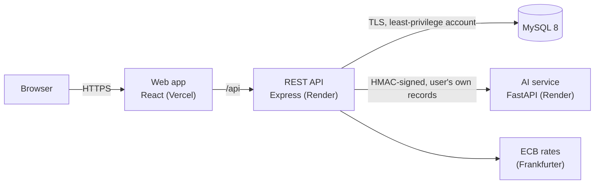

# FinTrack

**AI-powered personal finance management and cybersecurity platform.**

FinTrack is a multi-user web application for:

- recording income and expenses in five currencies
- planning with budgets and savings goals
- understanding spending through reports and an AI assistant
- seeing exactly how your account is protected

It is built like a real fintech product, with security as part of the architecture rather than
a feature added at the end.

> Portfolio project. **Fictional data only**: no bank connections, no real payments.

React · Tailwind CSS · Recharts · Node.js / Express · MySQL 8 · Python FastAPI · NumPy

## What it does

| Area | Highlights |
|---|---|
| Accounts | Register, sign in, **two-step sign-in with an authenticator app** and recovery codes, password reset by email, profile, active sessions, account deactivation |
| Money | Transactions with categories, payment methods, search, filters and pagination; **recurring transactions** (weekly, monthly, yearly, recorded automatically); **CSV import** with column mapping, preview and duplicate detection; monthly and category budgets with alerts; savings targets; savings goals with contributions and deadlines |
| Currencies | INR, USD, EUR, GBP, JPY. The original amount is always kept, together with the converted amount and the dated ECB rate used |
| Insights | Dashboard; reports by day, week, month and year; CSV export; printable reports |
| AI assistant | Plain-language questions about your own records, unusual expenses, month-end estimate, budget suggestions, regular payments. Run by a separate service that only ever receives your records, and never presented as advice or a guarantee |
| Notifications | Budget thresholds, unusual spending, transaction confirmations (including recurring and imported ones), security notices, monthly summaries |
| Security | Two-step sign-in (TOTP); bcrypt; AES-256-GCM field encryption; 15-minute JWT with rotating refresh tokens; role-based access; per-user isolation; validation; rate limits; CSRF protection; strict headers; lockouts; session revocation; security events; a tamper-evident audit hash chain |
| Administration | Usage statistics, account and role management, security monitoring, audit review with chain verification. Administrators cannot see anyone's financial records |

## Architecture

Three deployable services and one database. The API is the only component with database
access; the AI service is stateless and accepts only signed requests. Details in
[ARCHITECTURE.md](docs/ARCHITECTURE.md) and [DIAGRAMS.md](docs/DIAGRAMS.md).

## Quick start (local)

Requirements: Node.js 20+, Python 3.12, MySQL 8.0, Git. The full guide, with troubleshooting,
is [INSTALLATION.md](docs/INSTALLATION.md). In short:

1. From `backend/`: `npm install`, `npm run init:env`, then run
   `database/setup/setup.local.sql` once as MySQL root.
2. Still in `backend/`: `npm run migrate`, `npm run seed:demo`, `npm run dev`.
3. From `frontend/`: `npm install`, `npm run dev`.
4. From `ai-service/`: create `.venv`, install `requirements-dev.txt`, start uvicorn on port 8000.

Open http://localhost:5180 and sign in as `aarav.sharma@fintrack.demo` (user) or
`admin@fintrack.demo` (administrator). The demo password is in `backend/scripts/seed-demo.js`
(development only; the seed refuses to run in production).

## Quality

| Check | Result (version 1.1.0) |
|---|---|
| Backend tests (Jest + Supertest, real MySQL) | 294 passing |
| Frontend tests (Vitest + Testing Library + axe-core) | 206 passing |
| AI service tests (pytest) | 97 passing |
| Live security smoke test | 34 / 34 |
| Accessibility (axe, WCAG 2.2 AA, real browser) | 0 violations on every page |
| Production dependencies, known vulnerabilities | 0 |
| CI | GitHub Actions on every push: all suites, lint, build, migrations on a fresh MySQL, dependency audit |

Details: [TESTING.md](docs/TESTING.md) and [TEST_REPORT.md](docs/TEST_REPORT.md).

## Deployment

Vercel (web app), Render (API and AI service, `render.yaml`), a managed MySQL (Aiven free plan)
and GitHub Actions for CI, migrations and operations. All of it fits in free tiers.
Step-by-step guide: [DEPLOYMENT.md](docs/DEPLOYMENT.md).

## Documentation

| Document | Contents |
|---|---|
| [Project overview](docs/PROJECT_OVERVIEW.md) | Problem statement, objectives, scope, roles, requirements traceability |
| [Architecture](docs/ARCHITECTURE.md) | System architecture, technology decisions, folder structure, API conventions, security architecture |
| [Diagrams](docs/DIAGRAMS.md) | Use-case diagram; data-flow diagrams at levels 0, 1 and 2 |
| [Database design](docs/DATABASE_DESIGN.md) | ER diagram, tables, constraints, MySQL accounts |
| [Database setup](database/README.md) | Migrations, accounts, commands |
| [API](docs/API.md) | Conventions, authentication, every endpoint; [OpenAPI](backend/docs/openapi.yaml) and [Postman](backend/docs/FinTrack.postman_collection.json) files |
| [Security](docs/SECURITY.md) | Every security control, where it lives, its test, and its limits |
| [Installation](docs/INSTALLATION.md) | Local setup and troubleshooting |
| [Testing](docs/TESTING.md) and [test report](docs/TEST_REPORT.md) | Strategy, how to run, results, coverage, defects fixed |
| [Deployment](docs/DEPLOYMENT.md) | Hosting, secrets, migrations, HTTPS, CORS, health checks, operations |
| [Future enhancements](docs/FUTURE_ENHANCEMENTS.md) | What could come next |
| Component guides | [backend](backend/README.md), [frontend](frontend/README.md), [AI service](ai-service/README.md) |

## Repository layout

| Path | Contents |
|---|---|
| `backend/` | Express REST API: the only component with database access |
| `frontend/` | React single-page application |
| `ai-service/` | FastAPI analytics service, called only by the API |
| `database/` | Migrations and one-time setup SQL |
| `docs/` | Project documentation |
| `render.yaml`, `.github/workflows/` | Deployment Blueprint; CI, migration and operations workflows |

## Development history

Built in ten phases, each finished only after its tests passed:

1. Requirements and design
2. Database
3. API foundation
4. Frontend foundation
5. Authentication
6. Money features
7. Security hardening
8. AI assistant
9. Testing and security verification
10. Deployment and documentation

The plan and exit checks are in [ARCHITECTURE.md](docs/ARCHITECTURE.md) section 7.

## Secrets

Real `.env` files are git-ignored. Each service has a `.env.example` with placeholders only.
Production secrets live in the hosting providers' and GitHub's encrypted settings.
