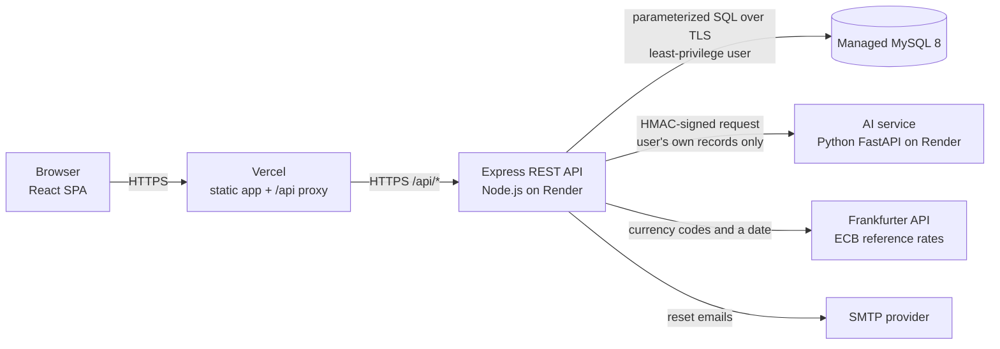
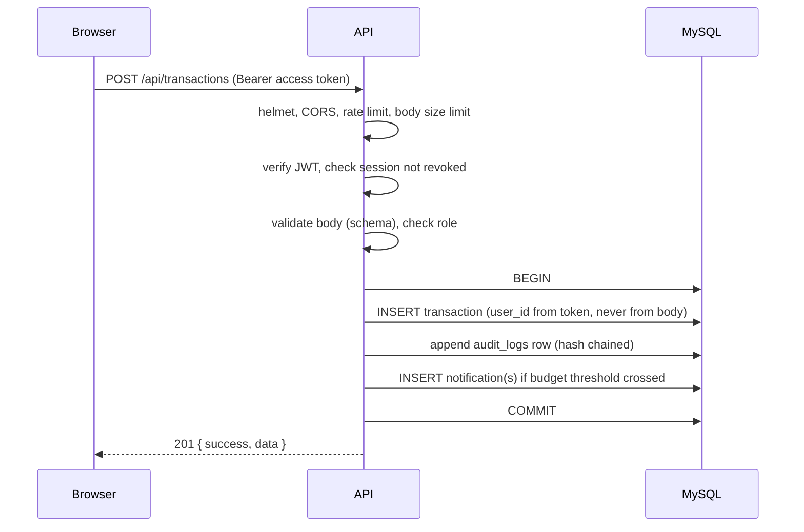

# FinTrack – Architecture

Status: **built and tested (Phases 1–10).** Written in Phase 1 as the design, and updated
whenever a decision changed. Where the build differs from the original plan, this document
describes the build. Problem statement and objectives in more detail:
[PROJECT_OVERVIEW.md](PROJECT_OVERVIEW.md). Diagrams (use cases, data flow):
[DIAGRAMS.md](DIAGRAMS.md).

## 1. Problem statement and objectives

People track money in scattered places and have little insight into where it goes, while
most student-grade finance apps treat security as an afterthought. FinTrack is a
multi-user personal finance platform where every user has an isolated ledger
(income, expenses, budgets, savings goals, multiple currencies), gets explainable
analytics and AI insights over their own data, and where security controls
(authentication, authorization, encryption, auditability) are part of the architecture.

Constraints: fictional data only, no bank integrations, no real payments.

## 2. System architecture



Work that a scheduler would do (monthly summaries, anchor exports) runs on demand: monthly
summaries when the user opens notifications, anchors with `npm run audit:anchor`. There is no
background job process.

Three deployable units, one database:

| Unit | Responsibility | Talks to |
|---|---|---|
| `frontend/` | UI only. Holds no secrets. | API |
| `backend/` | The only component with database credentials. Authentication, authorization, validation, business rules, encryption, audit, notifications, scheduled jobs. | MySQL, AI service, FX API, SMTP |
| `ai-service/` | Stateless analytics: summaries, anomaly detection, month comparison, budget suggestions, question answering. | Nobody (called by API only) |

### Why the AI service has no database access
"The AI must only access authorized user data" is enforced by construction rather than by
trust: the API authenticates the user, loads **that user's** records, and sends them in the
request body to the AI service over an HMAC-signed internal call. The AI service has no DB
credentials and is not reachable from the browser, so it cannot read another user's data
even if it has a bug.

### Request flow (data flow, level 1)



## 3. Technology decisions

Installed locally and verified: Node 24.21, npm 11.19, Python 3.12.10, MySQL Server 8.0
(service running), Git 2.56. Exact package versions are pinned in `package.json` /
`requirements.txt` when each phase installs them; the table gives the major line.

| Area | Choice | Reason |
|---|---|---|
| API framework | Express 5 | Async errors propagate to the central handler without wrappers |
| MySQL driver | `mysql2` (promise pool, prepared statements) | Parameterized queries everywhere; `DECIMAL` returned as strings so no float rounding |
| Money arithmetic | `decimal.js` in Node, `Decimal` in Python | Never JavaScript `Number` for amounts |
| Validation | Zod schemas in `validators/` | One schema validates and strips unknown fields |
| Passwords | `bcrypt`, cost 12 | Required by spec |
| Access token | JWT (HS256), 15 minutes, kept **in memory** in the SPA | Not in `localStorage`, so XSS cannot read it from storage |
| Refresh token | Opaque 256-bit random value in an `httpOnly; Secure; SameSite=Strict` cookie scoped to `/api/auth`; only its SHA-256 hash is stored | Rotation on every use; reuse of an old token revokes the whole session |
| Field encryption | Node `crypto` AES-256-GCM, key from env, key version prefix, row-bound AAD | See section 6 |
| Headers / limits | `helmet`, `cors` allow-list, `express-rate-limit` | |
| Logging | `pino` with redaction paths for passwords, tokens, cookies, authorization header | Secrets never reach logs |
| Scheduled work | None (changed from the plan's `node-cron`) | Rates are fetched when a conversion needs them, monthly summaries are created when notifications are opened, expired tokens are rejected on use. Free hosting sleeps idle services, so an in-process scheduler would not run reliably anyway |
| API docs | OpenAPI 3 file served by Swagger UI at `/api/docs`, plus a Postman collection | |
| Frontend | React + Vite, React Router, Tailwind CSS, Recharts, Axios | Required by spec |
| AI | FastAPI, NumPy | Robust z-score + Isolation Forest for anomalies. Built with NumPy instead of scikit-learn/pandas: a Windows application-control policy blocks a scikit-learn library on the development machine (see ai-service/README.md) |
| Backend tests | Jest + Supertest against a separate `fintrack_test` database | |
| Frontend tests | Vitest + React Testing Library | **Deviation from spec (Jest):** Vitest is the Jest-compatible runner for Vite projects; same API, no Babel duplication. Say so if you want Jest on the frontend too. |

### External services and free alternatives

| Need | Service | Cost | Development alternative |
|---|---|---|---|
| Exchange rates | Frankfurter (`api.frankfurter.dev`, ECB data) | Free, no key | Last stored snapshot is used if the API is down |
| Password-reset email | Any SMTP (Brevo or Resend free tier) | Free tier | With `SMTP_HOST` empty, mails are written to `backend/tmp/mail/` as text files; no account needed |
| AI question answering | Built-in rule-based engine | Free | No paid AI API is used or needed (an LLM phrasing layer was considered and not built) |
| Managed MySQL | Aiven for MySQL (free plan) | Free tier | Local MySQL 8.0. TiDB Serverless was considered and dropped: it does not support triggers, which protect the audit log |
| Hosting | Vercel (frontend), Render (API and AI service) | Free tier | Local; `npm run serve:dist` serves the production build the way Vercel does |
| CI | GitHub Actions | Free for public repositories | Run the same commands locally |

## 4. Folder structure

```
FinTech/
├── README.md
├── render.yaml                Render Blueprint: API and AI service
├── .github/workflows/         ci.yml (tests on every push), migrate.yml (production migrations, manual)
├── docs/                      Overview, architecture, diagrams, database, API, security,
│                              installation, testing, deployment, future enhancements
├── database/
│   ├── migrations/            Numbered .sql files (001-006), applied in order; 006 holds the reference data
│   └── setup/                 One-time SQL that creates the databases and least-privilege accounts
│                              (local file generated by init:env; production template)
├── backend/
│   ├── server.js              Validates config, checks the database, listens, shuts down cleanly
│   ├── app.js                 Builds the Express app (importable by tests without listening)
│   ├── config/                env validation, DB pool, database TLS, constants
│   ├── routes/                URL -> controller mapping, attaches validation, auth and limits per route
│   ├── controllers/           HTTP in/out only
│   ├── services/              Business rules, transactions, audit, outbound clients (FX, AI, mail)
│   ├── models/                All SQL (one file per table or aggregate)
│   ├── validators/            Zod schemas for body, query, params
│   ├── middleware/            requestContext, rateLimiters, validate, authenticate/authorize, csrf, errorHandler
│   ├── security/              passwords, tokens, fieldCrypto (AES-256-GCM), auditChain
│   ├── utils/                 ApiError, response helpers, money, dates, periods, logger
│   ├── scripts/               init-env, migrate, seed-demo, audit-chain, rotate-encryption-key,
│   │                          make-admin, security-smoke, build-postman
│   ├── docs/                  openapi.yaml (served at /api/docs), Postman collection and environment
│   └── tests/                 unit/, integration/, security/
├── frontend/
│   ├── vercel.json            Vercel build, /api proxy, SPA fallback, security headers
│   ├── scripts/serve-dist.mjs Serves the production build locally with the same headers and proxy
│   └── src/
│       ├── main.jsx, App.jsx
│       ├── routes/            Route table, guards (ProtectedRoute, AdminRoute, PublicOnlyRoute), navigation list
│       ├── layouts/           PublicLayout, AppLayout (sidebar, top bar, mobile menu)
│       ├── pages/             One folder per page
│       ├── components/        ui/ (design system), app/ (page building blocks), charts/, auth/, layout/
│       ├── services/          The single Axios client and one module per API area
│       ├── context/, hooks/   AuthProvider; useAuth, useAsync, useSubmit, useNotificationCount, useDocumentTitle
│       ├── utils/             format, dates, options, download, password rules, security labels
│       ├── styles/            Tailwind entry and design tokens
│       └── test/              Test setup, render helper, accessibility checks
└── ai-service/
    ├── app/
    │   ├── main.py            FastAPI app factory, routes, error handlers
    │   ├── config.py          Settings (refuses to start without a proper shared secret)
    │   ├── security.py        HMAC signature check and replay guard
    │   ├── schemas.py         Pydantic request models (unknown fields rejected)
    │   ├── money.py, wire.py  Decimal helpers and JSON output
    │   └── services/          analysis, anomalies, iforest, forecast, suggestions, insights, assistant, periods
    ├── tests/
    └── requirements.txt       (requirements-dev.txt adds pytest, coverage, pip-audit)
```

Layer rule in the backend: `routes → controllers → services → models`. Controllers never
write SQL; models never see `req`/`res`. This keeps authorization and transactions in one
place (services) and makes each layer testable alone.

## 5. API conventions

- Base path `/api`. JSON only. Body limit 100 kB.
- Success: `{ "success": true, "data": …, "meta": { pagination… } }`
- Failure: `{ "success": false, "error": { "code": "VALIDATION_ERROR", "message": "…", "details": [...] } }`
- Status codes: 400 validation, 401 unauthenticated, 403 forbidden, 404 not found
  (also returned for another user's resource, so IDs are not confirmable), 409 conflict,
  423 account locked, 429 rate limited, 500 internal (no stack trace in the body).
- Every response carries `X-Request-Id`, which also appears in logs and audit rows.
- Endpoint groups: `auth`, `users`, `transactions`, `categories`, `budgets`, `goals`,
  `currencies`, `analytics`, `reports`, `assistant`, `notifications`, `security`, `admin`, `health`.
  The full contract is written to `backend/docs/openapi.yaml` as each route is implemented.

## 6. Security architecture

| # | Requirement | Design |
|---|---|---|
| 1 | Password hashing | bcrypt cost 12; password policy validated server-side; constant-shape login errors (no user enumeration) |
| 2–3 | AES-256-GCM, env-based keys | `ENCRYPTION_KEYS` holds versioned 32-byte keys; stored value is `v<N>.<iv>.<tag>.<ciphertext>` (base64url). A fresh 96-bit IV per write. AAD = `table:column:owner_user_id`, so a ciphertext copied to another row or user fails authentication. Old key versions stay readable; a re-encrypt script rotates. Encrypted fields: `users.phone_enc`, `transactions.notes_enc`, `savings_goals.notes_enc`. Searchable fields (description, amount, date) stay plaintext by design. |
| 4 | JWT | Short-lived access token carrying `sub`, `sid`, `roles`; algorithm pinned on verify |
| 5 | RBAC | `roles` / `user_roles`; `authorize('ADMIN')` middleware; roles re-read from DB via the session check so changes apply at once |
| 6 | Resource authorization | `user_id` always comes from the token and is part of every `WHERE`; no endpoint accepts a user id for owned data |
| 7–8 | Middleware and validation | Zod on body, query and params; unknown fields stripped |
| 9 | SQL injection | Prepared statements only; sort/filter columns chosen from allow-lists, never interpolated |
| 10 | XSS | React escaping, no `dangerouslySetInnerHTML`, strict CSP via helmet, access token not in web storage, CSV export neutralises formula prefixes |
| 11 | CSRF | Data endpoints authenticate with a header token, which browsers do not attach cross-site. Cookie endpoints (`/auth/refresh`, `/auth/logout`) use `SameSite=Strict`, an `Origin` allow-list check and a required custom header. In production the frontend proxies `/api` (Vercel rewrite) so the cookie stays first-party. |
| 12 | Rate limiting | Global limiter plus strict limiters on login, register, forgot-password and assistant |
| 13 | HTTP headers | helmet (CSP, HSTS, no-sniff, frame-deny, referrer policy) |
| 14 | Login monitoring | Failed attempts counted per account; temporary lock after 5; every attempt written to `security_events`; user notified |
| 15 | Session revocation | `user_sessions` row per login; user can list and revoke sessions; password change revokes all others; middleware rejects tokens whose `sid` is revoked |
| 16 | Security events | `security_events` table with type, severity, IP, user agent |
| 17–18 | Audit trail + hash chain | See below |

### Tamper-evident audit log

Each row stores `prev_hash` and
`curr_hash = HMAC-SHA256(AUDIT_HMAC_KEY, prev_hash ‖ canonical_json(row fields))`.
Appends are serialized by locking a single-row `audit_chain_head` table inside the same
database transaction as the business change, so the chain cannot fork under concurrency
and an action is never committed without its audit row.

Layers around the chain (the chain alone only *detects* edits):

1. The application's MySQL user gets `SELECT, INSERT` on `audit_logs`, no `UPDATE`/`DELETE`.
2. `BEFORE UPDATE` / `BEFORE DELETE` triggers reject changes for every user.
3. `npm run audit:verify` (`scripts/audit-chain.js`) and an admin endpoint recompute the chain and report the first broken link.
4. The chain head hash is exported periodically to a location outside the database
   (anchor file / separate backup), so truncating the tail is also detectable.

Honest limit: someone holding both DB admin rights and the HMAC key could rebuild a
consistent chain. The independent anchor and backups are what make that detectable; no
claim is made that the log is impossible to alter.

### Administrator privacy boundary
Admin endpoints return account metadata, aggregate usage counts, security events and audit
metadata. No admin route selects from `transactions`, `budgets` or `savings_goals` row
data, audit rows store changed field *names* and resource ids rather than financial values,
and a security test asserts an admin token gets 404/403 on another user's records.

## 7. Development plan

| Phase | Deliverable | Exit check |
|---|---|---|
| 1 | Architecture, DB design, repository skeleton | This document reviewed |
| 2 | Migrations, seeds, least-privilege DB users, migration runner | Schema applies cleanly to an empty DB; constraints tested with bad inserts |
| 3 | API foundation: config, pool, error handling, response format, health, logging, OpenAPI skeleton | `GET /api/health` green; Jest harness running |
| 4 | Frontend foundation: Tailwind design system, layouts, routing, Axios client, landing page | Builds; routes render; lint clean |
| 5 | Auth end to end: register, login, refresh rotation, logout, forgot/reset, profile, sessions, RBAC | Supertest auth suite + manual browser run |
| 6 | Financial modules: categories, transactions, budgets, goals, currencies, dashboard, analytics, reports, notifications | CRUD + cross-user isolation tests per module |
| 7 | Security hardening: field encryption, audit chain, security events, security settings page, admin dashboard | Security test suite (injection, IDOR, bypass, rate limit, expiry, crypto, chain verify) |
| 8 | AI service and assistant page | pytest for analytics; API ↔ AI integration test |
| 9 | Full test pass, bug fixing, accessibility and responsive review | All suites green; test report written |
| 10 | Deployment configs, migrations in CI, full documentation set | Deployed health check; docs complete |

Rule for every phase: a feature is reported as done only after its tests have run.
