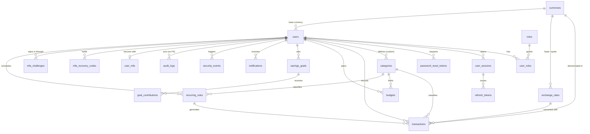

# FinTrack – Database Design (Phase 1)

Engine: MySQL 8.0, InnoDB, `utf8mb4` / `utf8mb4_0900_ai_ci`. All timestamps are UTC
(`DATETIME(3)`, session `time_zone = '+00:00'`). The executable schema is the set of
migrations in `database/migrations/` (17 tables plus `schema_migrations`), verified by
`backend/tests/integration/schema.test.js`.

## Conventions

- Primary keys: `BIGINT UNSIGNED AUTO_INCREMENT`.
- Money: `DECIMAL(18,2)`; exchange rates: `DECIMAL(18,8)`. Never `FLOAT`/`DOUBLE`.
- Every user-owned table has `user_id` with a foreign key and a composite index starting
  with `user_id`; every query in `models/` filters on it (user-level isolation).
- `created_at` on every table, `updated_at` on mutable tables.
- Enumerations use `ENUM` when the set is fixed by code, lookup tables when users or admins extend it.
- Multi-row operations (transaction + audit + notification, token rotation, goal
  contribution) run inside one database transaction.

## Entity-relationship diagram

## Tables

### Identity and access

**roles** – `id`, `name` UNIQUE (`USER`, `ADMIN`), `description`.

**users**
| Column | Type | Notes |
|---|---|---|
| id | BIGINT UNSIGNED PK | |
| full_name | VARCHAR(100) NOT NULL | |
| email | VARCHAR(254) NOT NULL UNIQUE | stored lower-cased |
| password_hash | VARCHAR(100) NOT NULL | bcrypt |
| phone_enc | VARCHAR(255) NULL | AES-256-GCM |
| base_currency | CHAR(3) NOT NULL FK → currencies | default `INR` |
| status | ENUM('ACTIVE','DEACTIVATED','SUSPENDED') | deactivation is a status, rows are not deleted |
| failed_login_count | SMALLINT UNSIGNED DEFAULT 0 | |
| locked_until | DATETIME(3) NULL | temporary lockout |
| password_changed_at, last_login_at | DATETIME(3) | tokens issued before `password_changed_at` are rejected |
| created_at, updated_at | DATETIME(3) | |

**user_roles** – `user_id` FK, `role_id` FK, `granted_by` FK → users NULL, `granted_at`; PK (`user_id`,`role_id`).

**user_sessions** – `id`, `user_id` FK, `ip_address` VARCHAR(45), `user_agent` VARCHAR(255),
`created_at`, `last_used_at`, `expires_at`, `revoked_at` NULL, `revoke_reason`.
Index (`user_id`,`revoked_at`). The JWT carries the session id.

**refresh_tokens** – `id`, `session_id` FK ON DELETE CASCADE, `token_hash` CHAR(64) UNIQUE
(SHA-256 of the token; the token itself is never stored), `issued_at`, `expires_at`,
`used_at` NULL, `replaced_by` FK → refresh_tokens NULL. A token presented after `used_at`
is set means theft or replay: the session is revoked.

**password_reset_tokens** – `id`, `user_id` FK, `token_hash` CHAR(64) UNIQUE, `expires_at`
(30 minutes), `used_at` NULL, `requested_ip`. Single use.

### Reference data

**currencies** – `code` CHAR(3) PK, `name`, `symbol`, `decimal_places` TINYINT (JPY = 0),
`is_active`. Seeded: INR, USD, EUR, GBP, JPY.

**exchange_rates** – `id`, `base_currency` FK, `quote_currency` FK, `rate` DECIMAL(18,8)
CHECK (`rate` > 0), `rate_date` DATE, `source` VARCHAR(50), `fetched_at` DATETIME(3).
UNIQUE (`base_currency`,`quote_currency`,`rate_date`). Rows are never updated: each fetch
for a new date is a new snapshot, which gives the historical record.

**categories** – `id`, `user_id` FK NULL (NULL = system default visible to all),
`name` VARCHAR(50), `type` ENUM('INCOME','EXPENSE'), `icon`, `color`, `is_archived`.
UNIQUE (`owner_key`,`name`,`type`) where `owner_key` is a generated column
`COALESCE(user_id, 0)`, because MySQL unique indexes treat NULLs as distinct.

### Ledger

**transactions**
| Column | Type | Notes |
|---|---|---|
| id | BIGINT UNSIGNED PK | |
| user_id | FK → users | |
| category_id | FK → categories, ON DELETE RESTRICT | categories are archived, not deleted |
| type | ENUM('INCOME','EXPENSE') | |
| amount | DECIMAL(18,2) CHECK > 0 | **original amount, never rewritten by conversion** |
| currency_code | CHAR(3) FK → currencies | original currency |
| base_currency | CHAR(3) FK → currencies | user's base currency at entry time |
| exchange_rate | DECIMAL(18,8) | rate applied (1 when same currency) |
| exchange_rate_id | FK → exchange_rates NULL | the snapshot used, gives the rate timestamp |
| base_amount | DECIMAL(18,2) | `amount × exchange_rate`, used for totals and charts |
| description | VARCHAR(255) | searchable |
| notes_enc | TEXT NULL | AES-256-GCM private note |
| payment_method | ENUM('CASH','CARD','UPI','BANK_TRANSFER','WALLET','OTHER') | a label only, no account numbers |
| txn_date | DATE NOT NULL | |
| deleted_at | DATETIME(3) NULL | soft delete keeps history consistent with the audit trail |
| created_at, updated_at | DATETIME(3) | |

Indexes: (`user_id`,`txn_date`), (`user_id`,`type`,`txn_date`), (`user_id`,`category_id`,`txn_date`),
FULLTEXT(`description`).

If a user changes base currency, `base_*` columns are recomputed from the untouched
original `amount` using the historical snapshot for each `txn_date`.

**recurring_rules** (migration 008): `id`, `user_id` FK, `category_id` FK, `type`, `amount` DECIMAL(18,2) CHECK > 0,
`currency_code` FK, `description`, `payment_method`, `frequency` ENUM('WEEKLY','MONTHLY','YEARLY'),
`start_date`, `end_date` NULL (CHECK ≥ start), `next_index`, `next_date`, `paused`, `last_run_at`, timestamps.
Occurrence *n* is `start_date` + *n* periods (clamped to the month's last day). Generated
transactions carry `transactions.recurring_rule_id` (FK, ON DELETE SET NULL), and the unique key
(`recurring_rule_id`, `txn_date`) guarantees each occurrence is created once. A soft-deleted
occurrence keeps its slot, so it is not recreated.

**budgets** – `id`, `user_id` FK, `budget_type` ENUM('CATEGORY','OVERALL','SAVINGS_TARGET'),
`category_id` FK NULL (required only for CATEGORY, enforced by CHECK), `period_month` DATE
(first day of month, CHECK `DAY(period_month)=1`), `amount` DECIMAL(18,2) CHECK > 0,
`alert_threshold_pct` TINYINT DEFAULT 80, `created_at`, `updated_at`.
UNIQUE (`user_id`,`period_month`,`budget_type`,`category_key`). One row per month, so past
months are the budget history. Utilization is computed from transactions, not stored.

**savings_goals** – `id`, `user_id` FK, `title`, `target_amount` DECIMAL(18,2) CHECK > 0,
`saved_amount` DECIMAL(18,2) DEFAULT 0 CHECK >= 0, `currency_code` FK, `deadline` DATE NULL,
`notes_enc`, `status` ENUM('IN_PROGRESS','COMPLETED','CANCELLED'), timestamps.

**goal_contributions** – `id`, `goal_id` FK ON DELETE CASCADE, `user_id` FK, `amount`
DECIMAL(18,2) (negative = withdrawal), `contributed_on` DATE, `created_at`.
`saved_amount` is updated in the same DB transaction as the contribution insert.

### Two-step sign-in (migration 007)

- **user_mfa**: `user_id` (unique) FK, `secret_enc` (AES-256-GCM TOTP secret, context `user_mfa:secret_enc:<user_id>`), `enabled_at` (NULL until confirmed), `last_used_step` (a code works once).
- **mfa_recovery_codes**: `user_id` FK, `code_hash` CHAR(64) (SHA-256, unique per user), `used_at`.
- **mfa_challenges**: `user_id` FK, `token_hash` CHAR(64) unique, `attempts` (max 5), `expires_at` (5 minutes), `used_at`.

### Notifications and security

**notifications** – `id`, `user_id` FK, `type` ENUM('BUDGET_THRESHOLD','UNUSUAL_SPENDING',
'TRANSACTION','SECURITY','MONTHLY_SUMMARY'), `title`, `message`, `severity`
ENUM('INFO','WARNING','CRITICAL'), `dedupe_key` VARCHAR(100) NULL, `read_at` NULL,
`created_at`. UNIQUE (`user_id`,`dedupe_key`) stops the same budget alert firing twice in
a month. Index (`user_id`,`read_at`,`created_at`).

**security_events** – `id`, `user_id` FK NULL (NULL for unknown-email login attempts; users
are never hard-deleted, so no delete action is needed), `event_type` (LOGIN_SUCCESS, LOGIN_FAILED, ACCOUNT_LOCKED, TOKEN_REUSE,
PASSWORD_CHANGED, PASSWORD_RESET_REQUESTED, SESSION_REVOKED, ROLE_CHANGED,
ACCESS_DENIED, RATE_LIMITED…), `severity`, `ip_address`, `user_agent`, `metadata` JSON
(never secrets), `created_at`. Indexes (`user_id`,`created_at`), (`event_type`,`created_at`).

**audit_logs**
| Column | Type | Notes |
|---|---|---|
| id | BIGINT UNSIGNED PK | chain order |
| user_id | BIGINT UNSIGNED NULL | **deliberately no foreign key**: an FK action would have to modify audit rows |
| event_type | VARCHAR(40) | AUTH, TRANSACTION, BUDGET, GOAL, PROFILE, ADMIN, EXPORT… |
| action | VARCHAR(40) | CREATE, UPDATE, DELETE, LOGIN, EXPORT… |
| resource_type, resource_id | VARCHAR(40), VARCHAR(64) | |
| details | JSON | changed field names, never amounts, notes or secrets |
| ip_address, request_id | | |
| created_at | DATETIME(3) | |
| prev_hash | CHAR(64) | hash of the previous row (64 zeros for the first) |
| curr_hash | CHAR(64) UNIQUE | HMAC-SHA256 over prev_hash + canonical row |

Protected by: no `UPDATE`/`DELETE` grant for the application user, `BEFORE UPDATE` and
`BEFORE DELETE` triggers that raise an error, and periodic export of the head hash outside
the database.

**audit_chain_head** – single row (`id` = 1, `last_id`, `last_hash`), locked `FOR UPDATE`
to serialize appends.

**schema_migrations** – `version`, `name`, `checksum`, `applied_at`; maintained by the migration runner.

## MySQL accounts (least privilege)

| Account | Used by | Privileges |
|---|---|---|
| `fintrack_migrator` | migration runner only | DDL + DML on `fintrack.*` |
| `fintrack_app` | the API at runtime | `SELECT, INSERT, UPDATE, DELETE` on business tables; **`SELECT, INSERT` only** on `audit_logs`, `security_events`, `exchange_rates`; no DDL |
| `fintrack_backup` | scheduled dumps | `SELECT, LOCK TABLES, SHOW VIEW` |

The API never connects as `root`.

## Seed data (Phase 2)

- Reference: 2 roles, 5 currencies, default income and expense categories.
- Demo (fictional): one admin and three users with 6 months of transactions in mixed
  currencies, budgets, goals and notifications, generated by a seed script so passwords are
  hashed by the real code path. Demo credentials are documented in the seed file only.
