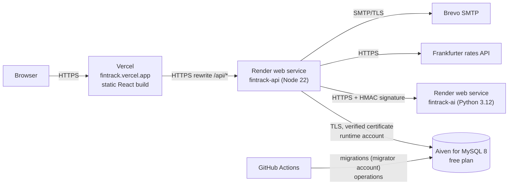

# FinTrack deployment guide

How to put FinTrack on the internet with free hosting tiers, how each requirement (HTTPS,
production CORS, migrations, health checks, secrets) is met, and how to run it afterwards.

> **Status.** All configuration in this guide was checked locally:
>
> - The production-mode API was run and probed.
> - The production build was served with the exact Vercel headers and proxy, then used end to
>   end in a browser.
> - The config files parse, and the workflows reuse the commands CI runs locally.
>
> Nothing has been deployed to real accounts yet, because that needs your own logins. Section 9
> is the checklist to run after the first deployment.

## 1. Target layout



| Piece | Service | Cost | Config in this repository |
|---|---|---|---|
| Web app | Vercel (Hobby) | Free | `frontend/vercel.json` |
| API | Render web service | Free (sleeps after 15 idle minutes) | `render.yaml` |
| AI service | Render web service | Free (same) | `render.yaml` |
| Database | Aiven for MySQL, free plan | Free | `database/setup/setup.production.template.sql` |
| Email | Brevo SMTP (300 mails a day) | Free | environment variables |
| CI, migrations, operations | GitHub Actions | Free for public repositories | `.github/workflows/` |

**Why the API is proxied through Vercel.** The browser only ever talks to the Vercel domain,
so the refresh-token cookie is first-party and `SameSite=Strict` keeps working. The
alternative, calling `onrender.com` directly, would make it a third-party cookie, which
browsers increasingly block. It also means one origin for CSP and CORS.

## 2. Before you start

You need accounts at GitHub, Aiven, Render and Vercel (all free), and optionally Brevo for
email. Without SMTP, password-reset mails cannot be delivered in production. Everything else
works.

Generate **new** secrets for production. Never reuse the development ones from `backend/.env`.
Run this four times, once each for `JWT_ACCESS_SECRET`, the encryption key, `AUDIT_HMAC_KEY`
and `AI_SERVICE_SHARED_SECRET`:

```bash
node -e "console.log(require('crypto').randomBytes(32).toString('hex'))"
```

Keep them in a password manager. They go into Render and GitHub secrets only, never into a file
in the repository.

- **Losing the encryption key** makes phone numbers and notes unreadable.
- **Losing the audit key** means the existing audit chain can no longer be verified.

## 3. Database (Aiven for MySQL)

1. Create a **MySQL** service on the free plan, in a region near your Render region
   (`render.yaml` uses Frankfurt).
2. On the service page, note host, port, admin user (`avnadmin`) and password, and download
   the **CA certificate** (`ca.pem`).
3. **Advanced configuration:** set `log_bin_trust_function_creators` to on. The migrator
   account needs it to create the audit-log protection triggers. If your provider has no such
   setting, run the migrations once as the admin user instead.
4. **Allowed IP addresses:** the free plans of Render and GitHub Actions have no fixed outbound
   addresses, so leave the default (any address). Every account below *requires TLS*, and the
   passwords are long and random.
5. Copy `database/setup/setup.production.template.sql` to `setup.production.local.sql` (that
   name is git-ignored). Choose the database name (for example `fintrack`), fill in three new
   random passwords, and run it as the admin user:
   ```bash
   mysql --ssl-mode=VERIFY_IDENTITY --ssl-ca=ca.pem -h <host> -P <port> -u avnadmin -p < setup.production.local.sql
   ```
   It creates `fintrack_migrator` (schema owner), `fintrack_app` (runtime, privileges granted
   table by table by the migration runner) and `fintrack_backup` (read-only). Delete the
   filled-in file afterwards.

The API refuses to start in production against a remote database without `DB_SSL=true`,
and it always verifies the server certificate.

## 4. GitHub: CI, secrets and migrations

1. Push the repository to GitHub (check `git status` first: no `.env`, `*.local.sql`,
   anchors or `tmp/` may appear). The **CI** workflow runs on every push:
   - the API tests against a real MySQL 8
   - migrations applied twice on a fresh database
   - the demo seed and an audit-chain check
   - the web app's lint, tests and build
   - the AI service's tests and dependency audit
2. **Settings → Environments → New environment "production".** Optionally add yourself as a
   required reviewer, so production workflows wait for your approval. Add these secrets:

   | Secret | Value |
   |---|---|
   | `DB_HOST`, `DB_PORT`, `DB_NAME` | From Aiven and your setup file |
   | `DB_USER`, `DB_PASSWORD` | `fintrack_app` and its password |
   | `DB_MIGRATOR_USER`, `DB_MIGRATOR_PASSWORD` | `fintrack_migrator` and its password |
   | `DB_SSL_CA` | Contents of `ca.pem` |
   | `JWT_ACCESS_SECRET`, `AUDIT_HMAC_KEY`, `AI_SERVICE_SHARED_SECRET` | Your new secrets |
   | `ENCRYPTION_KEYS`, `ENCRYPTION_ACTIVE_KEY_VERSION` | `1:<your key>` and `1` |
   | `CLIENT_ORIGINS` | `https://<your-app>.vercel.app` (fill in after step 6) |
   | `AI_SERVICE_URL` | `https://fintrack-ai.onrender.com` (after step 5) |

3. **Actions → "Migrate production database" → Run workflow:**
   1. Run it with `status` first; it lists the six pending migrations.
   2. Run it again with `apply`.
   3. A third `status` run should show everything applied.

   For later releases that add a migration, apply it **before** deploying the API that needs it.
   Migrations are forward-only: a schema change is undone by a new migration, never by editing
   an applied one (the runner refuses edited files).

## 5. API and AI service (Render)

1. **New → Blueprint**, connect the GitHub repository; Render reads `render.yaml` and proposes
   `fintrack-api` and `fintrack-ai`.
2. Fill in the values marked as required:
   - **`fintrack-ai`:** `AI_SERVICE_SHARED_SECRET`.
   - **`fintrack-api`:** the database values (runtime account), `DB_SSL_CA` (paste the PEM), the
     secrets, and `AI_SERVICE_URL=https://fintrack-ai.onrender.com`. Render shows the exact URL
     once the service exists.
   - `CLIENT_ORIGINS` and `APP_PUBLIC_URL` can be a placeholder such as
     `https://example.invalid` until step 6.
   - SMTP values come from Brevo (SMTP & API → SMTP). `MAIL_FROM` must be a sender address you
     verified there.
3. Deploy. Render builds each service and only switches traffic once the health check passes:
   - API: `GET /api/health/ready`, which checks the database and reports the schema version
   - AI service: `GET /health`
4. Check: `https://fintrack-api.onrender.com/api/health/ready` answers
   `{"success":true,"data":{"status":"ready","checks":{"database":"up"},"schemaVersion":"006"}}`.
   `/api/docs` answers 404, because interactive docs are off in production.

The AI service has a public URL on the free plan. It still cannot be used by anyone else:

- Every request must carry an HMAC-SHA256 signature made with the shared secret, at most 60
  seconds old and never seen before.
- It holds no data and no database credentials.

On a paid plan, change its `type` to `pserv` in `render.yaml` so it has no public address at all.

## 6. Web app (Vercel)

1. **Add New → Project**, import the repository, set **Root Directory** to `frontend`. Vercel
   picks up `vercel.json` (Vite, `npm ci`, `npm run build`, output `dist`). No environment
   variables are needed: the app calls `/api` on its own origin.
2. If your API URL is not `https://fintrack-api.onrender.com`, edit the destination of the
   `/api/:path*` rewrite in `frontend/vercel.json` and push.
3. Deploy, then put the production URL (`https://<your-app>.vercel.app`, no trailing slash)
   into `CLIENT_ORIGINS` and `APP_PUBLIC_URL` on the Render API service, and into the GitHub
   `CLIENT_ORIGINS` secret. Saving on Render redeploys the API.

**Preview deployments** get different URLs. They load, but signing in is refused because their
origin is not in `CLIENT_ORIGINS`. That is deliberate. Add a fixed preview domain to the list
if you want previews to work.

## 7. First administrator

Register an account on the deployed site, then **Actions → "Production operations" → Run
workflow** with task `make-admin` and that email address. The grant is written to the audit
trail. After that, administrators manage roles on the Admin page.

Demo data is never loaded in production: `npm run seed:demo` refuses to run when
`NODE_ENV=production`.

## 8. How each requirement is met

| Requirement | How |
|---|---|
| Frontend deployment | Vercel, `frontend/vercel.json`: Vite build, long-term caching for hashed assets, SPA fallback |
| Backend deployment | Render Blueprint `render.yaml`: `npm ci --omit=dev`, `npm start`, graceful shutdown on SIGTERM |
| Database hosting | Aiven for MySQL over verified TLS; three least-privilege accounts; the app account cannot change or delete audit rows |
| Environment variables | Validated at start-up (`backend/config/env.js`, `ai-service/app/config.py`). A missing, malformed or placeholder secret stops the process with a message naming the variable, never its value. `.env.example` files hold placeholders only |
| HTTPS | Vercel and Render issue and renew certificates. HSTS is sent by Vercel (2 years) and the API. The refresh cookie is `Secure`. The database connection is TLS 1.2+ with certificate verification. The CSP includes `upgrade-insecure-requests` |
| Production CORS | `CLIENT_ORIGINS` must list exact `https://` origins in production (anything else is refused at start-up). Cookie routes also check `Origin` and a custom header |
| Database migrations | Numbered, checksummed SQL files; CI applies them to a fresh database on every push; production uses the manual "Migrate production database" workflow with the migrator account |
| Health checks | `GET /api/health` (liveness), `GET /api/health/ready` (database and schema version; used by Render), AI `GET /health` |
| Secrets | Render and GitHub encrypted secrets; nothing secret in the repository (scanned in Phase 9) |
| Security headers on the web app | CSP (`script-src 'self'`, no inline scripts, `frame-ancestors 'none'`), HSTS, nosniff, `X-Frame-Options: DENY`, no referrer, a restrictive Permissions-Policy, COOP. Verified against the production build with no CSP violations |
| Client IP behind proxies | `TRUST_PROXY=2` (Vercel edge, then Render's proxy), so rate limits and sign-in history see the visitor's address. Simulated locally; confirm it after deployment (section 9) |

## 9. After the first deployment: checklist

1. `GET https://<api>/api/health/ready` gives `ready` and schema `006`.
2. Open the Vercel URL, register, and sign in. Reload the page and stay signed in, which
   proves the refresh cookie works through the proxy.
3. **Security** page: the sign-in shows *your* IP address. If it shows an address of Vercel or
   Render, adjust `TRUST_PROXY` (one more or one fewer) and check again.
4. Browser developer tools, Console: no Content-Security-Policy errors.
5. Add a transaction, set a budget, and open the AI assistant.
   - The first request after an idle period can take up to a minute while Render wakes the
     services.
   - If the assistant reports it is unavailable, try again once the AI service is awake.
6. `curl -sI https://<your-app>.vercel.app` shows `strict-transport-security` and
   `content-security-policy`.
7. Actions → "Production operations" → `verify-audit-chain`: "Chain intact".
8. Request a password reset and confirm the email arrives (only if SMTP is configured).

## 10. Running it

| Task | How |
|---|---|
| Deploy a new version | Push to `main`. CI runs, then Render and Vercel deploy automatically. Run the migration workflow first if the release adds a migration |
| Roll back | Render: Deploys → pick an earlier deploy → Rollback. Vercel: Deployments → Promote an earlier one. The database is not rolled back, so write each migration so that the previous release still works with the new schema (add first, remove in a later release) |
| Backups | Aiven takes automatic backups (check your plan's retention). Also export regularly with the read-only account: `mysqldump --single-transaction --ssl-mode=VERIFY_IDENTITY --ssl-ca=ca.pem -h <host> -P <port> -u fintrack_backup -p fintrack > fintrack.sql`, and store the file encrypted |
| Audit anchors | Weekly, run "Production operations" with `save-audit-anchor`, then download the artifact and keep it outside the database account (artifacts expire after 90 days) |
| Verify the audit chain | "Production operations" → `verify-audit-chain` |
| Rotate the encryption key | Add `2:<new key>` to `ENCRYPTION_KEYS`, set the active version to 2 on Render and in GitHub, redeploy, then run `npm run keys:rotate` with the production values. See [SECURITY.md](SECURITY.md) section 5 |
| Rotate the JWT secret | Change `JWT_ACCESS_SECRET` on Render; users' access tokens expire and refresh automatically |
| Logs | Render → service → Logs. The API writes JSON lines with request ids; passwords, tokens, cookies and request bodies are never logged |

## 11. Limits of the free setup

- **Cold starts.** Render's free services sleep after 15 idle minutes, and the first request
  then waits about a minute. The API's call to the AI service times out after 10 seconds, so the
  assistant can report "unavailable" until the AI service is awake. A paid instance, or an
  uptime monitor pinging `/api/health`, avoids this.
- **One API instance.** Rate-limit counters are kept in memory, which is correct for one
  instance. Several instances would need a shared store (for example Redis).
- **No scheduler.** Monthly summaries are created when users open notifications, and audit
  anchors are saved through the operations workflow.
- **Fixed IPs.** Free Render and GitHub runners have no fixed outbound IP, so the database
  cannot be restricted to known addresses; TLS and strong passwords protect it. Paid plans
  offer static outbound IPs.

## 12. Troubleshooting

| Symptom | Cause and fix |
|---|---|
| API exits at start: `DB_SSL: must be true in production…` | Set `DB_SSL=true` (the Blueprint does) |
| `HANDSHAKE_SSL_ERROR … self-signed certificate` | `DB_SSL_CA` is missing or wrong: paste the provider's `ca.pem` |
| `CLIENT_ORIGINS: production origins must use https` | Use the `https://` Vercel URL, no path, no trailing slash |
| Readiness answers 503 `database: down` | Wrong host or credentials, or the database service is powered off (check the provider console) |
| Migration fails creating triggers ("SUPER privilege") | Turn on `log_bin_trust_function_creators` (section 3), or run the migration once as the admin user |
| Sign-in answers 403 | The page's origin is not in `CLIENT_ORIGINS` (common on preview deployments) |
| Signed out on every reload | The `/api` rewrite in `vercel.json` points somewhere else, or the site is opened on a different domain than `CLIENT_ORIGINS` |
| Assistant reports it is unavailable | AI service asleep or `AI_SERVICE_SHARED_SECRET` differs between the two services |
| Every visitor shares one rate limit | `TRUST_PROXY` too low; see the checklist step 3 |
