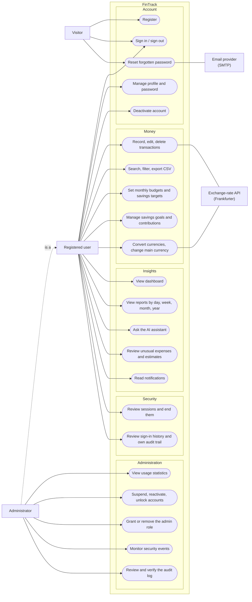
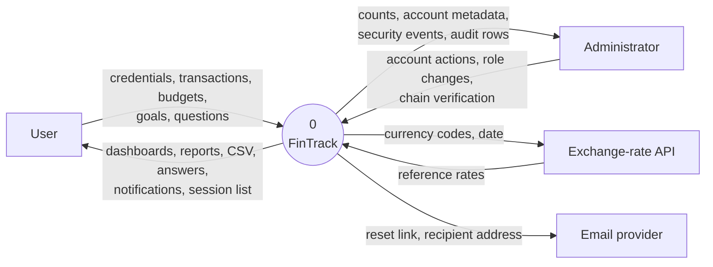
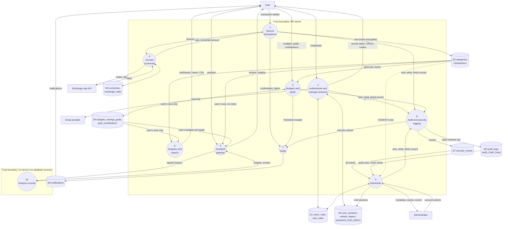
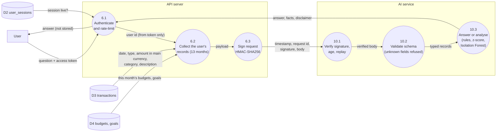

# FinTrack diagrams

Use cases and data flow. The diagrams are written in Mermaid, which GitHub and most Markdown
viewers draw directly. The ER diagram is in [DATABASE_DESIGN.md](DATABASE_DESIGN.md), and the
component diagram and a request sequence are in [ARCHITECTURE.md](ARCHITECTURE.md).

Notation in the data-flow diagrams:

| Shape | Meaning |
|---|---|
| Rectangle | External entity |
| Circle | Process |
| Cylinder | Data store |
| Labelled arrow | Data flow |
| Dashed box | Trust boundary |

## 1. Use-case diagram

Three human actors and two external systems. An administrator is also a user. The admin
use cases deliberately exclude reading anyone's financial records.



| Use case | Includes / extends |
|---|---|
| Record a transaction | includes *convert to the main currency* (rate looked up or fetched); extends to *budget alert*, *unusual-spending alert* and *transaction confirmation* |
| Sign in | includes *record security event*; extends to *lockout after 5 failures* and *new-device notice* |
| Reset forgotten password | includes *send email*; ends every session on completion |
| Ask the AI assistant | includes *collect the user's own records* and *signed call to the AI service* |
| Any change | includes *append to the audit trail* (same database transaction) |

## 2. Data-flow diagram, level 0 (context)



Nothing financial leaves the system: the rates API receives only currency codes and a date,
and the email provider receives an address and a reset link.

## 3. Data-flow diagram, level 1



What the level-1 diagram shows about the security design:

- **The AI service is a separate trust zone.** It receives only what process 6 sends: the
  signed-in user's transactions without notes, plus their budgets and goals. It reads no data
  store.
- **Administrators never read money rows.** Process 9 reads users, sessions, security events
  and audit rows. From the money tables it only receives counts.
- **Every change reaches the audit log.** Processes 2, 3 and 9, and the account changes in
  process 1, all feed process 8 inside the same database transaction. The audit rows hold
  field names and ids, never amounts or text.

## 4. Data-flow diagram, level 2: asking the AI assistant



## 5. Data-flow diagram, level 2: sign-in and session refresh

```mermaid
sequenceDiagram
    participant B as Browser
    participant A as API
    participant D as MySQL
    B->>A: POST /auth/login (email, password, X-Requested-With)
    A->>D: user by email; failed-attempt count
    A->>A: bcrypt compare (dummy hash for unknown emails)
    alt wrong password
        A->>D: count failure, security event (lock after 5)
        A-->>B: 401 (same message for unknown email)
    else correct
        A->>D: new user_sessions row, refresh-token hash, audit row
        A-->>B: 200 access token (15 min, kept in memory) + httpOnly cookie
    end
    Note over B,A: 15 minutes later, or after a reload
    B->>A: POST /auth/refresh (cookie, allowed Origin, X-Requested-With)
    A->>D: find token by SHA-256 hash, lock row
    alt token already used
        A->>D: revoke the whole session, security event, notify user
        A-->>B: 401
    else valid
        A->>D: mark used, store the next token's hash
        A-->>B: new access token + rotated cookie
    end
```
